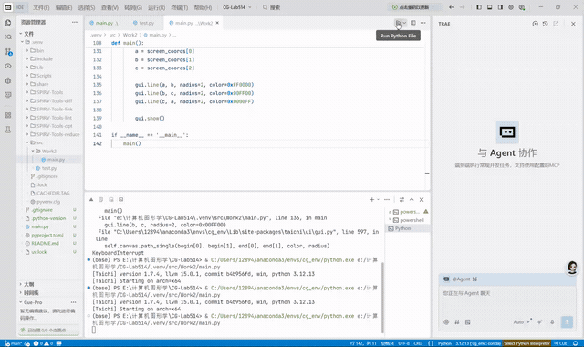
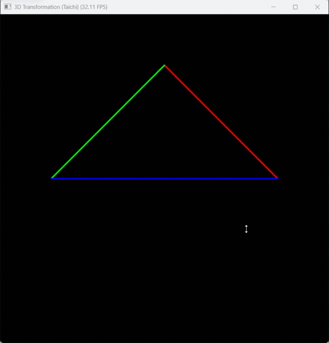
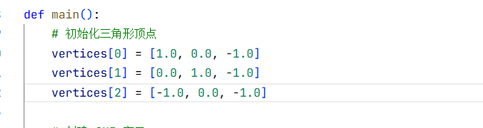
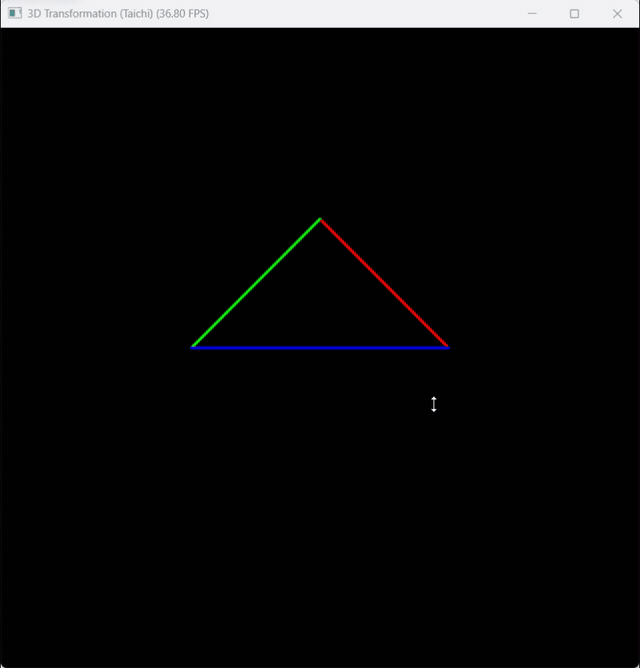

实验二 旋转与变换

姓名：黄馨莹

学号：202411081080

专业：计算机科学与技术

一、项目概述

本项目基于 Python + Taichi 实现三维 MVP（模型、视图、透视投影）完整坐标变换仿真系统，使用 Taichi CPU 并行架构完成三维三角形顶点矩阵变换、透视除法与视口映射，支持键盘按键实时控制模型绕 Z 轴旋转。项目完整复现计算机图形学三维渲染基础流水线，是理解三维坐标变换、透视投影原理的图形学入门实践项目。

二、项目架构
1. 项目目录结构

```
CG-Lab/
├── src/
│   └── Work2/
│       └── main.py        # 矩阵运算、顶点变换、交互渲染主程序
├── .gitignore
├── pyproject.toml         # 项目依赖管理文件
└── README.md
```

2. 模块职责
    
数据存储模块：通过 Taichi Field 分别存储原始三维三角形顶点、变换后二维屏幕坐标，数据托管至计算内核用于并行运算。

矩阵计算模块：封装三类变换矩阵函数，分别实现 Z 轴旋转模型矩阵、相机平移视图矩阵、标准透视投影矩阵，构成完整 MVP 变换链路。

并行计算模块：使用 ti.kernel 并行批量完成顶点齐次坐标转换、MVP 矩阵乘法、透视除法、NDC 标准化、视口坐标映射。

交互渲染模块：创建可视化 GUI 窗口，监听键盘 A/D 旋转控制与 ESC 退出事件，逐帧绘制三色三角形轮廓，实时刷新变换效果。

三、代码逻辑

1. 环境初始化与数据定义

初始化 Taichi 运行后端为 CPU，定义两个字段：3 个三维原始顶点字段 vertices、变换后二维屏幕坐标字段 screen_coords，为并行坐标变换提供数据载体。

2. 三大变换矩阵实现

模型矩阵 get_model_matrix：接收旋转角度，换算弧度后生成绕 Z 轴旋转 4×4 齐次变换矩阵，实现三角形整体旋转变换。
视图矩阵 get_view_matrix：接收相机世界坐标，生成平移矩阵将相机原点移至世界坐标原点，本项目相机固定在 (0,0,5)。
透视投影矩阵 get_projection_matrix：根据视场角、宽高比、近远裁剪面参数，分步实现透视截头体转长方体挤压矩阵、正交缩放平移矩阵，组合得到完整透视投影矩阵，实现近大远小透视效果。

3. 并行顶点变换内核 compute_transform
按 proj @ view @ model 右乘规则合并 MVP 总矩阵；遍历全部顶点，补齐四维齐次坐标，与 MVP 矩阵相乘得到裁剪空间坐标；执行透视除法得到 [-1,1] 区间 NDC 标准化设备坐标；最后视口变换将 NDC 坐标映射至 GUI [0,1] 归一化屏幕空间，存入 screen_coords 字段。

4. 主程序交互与渲染逻辑
预设三角形三维顶点初始位置，创建 700×700 分辨率 GUI 窗口。主循环持续监听键盘事件：按 A 增加旋转角度、按 D 减小旋转角度、ESC 关闭窗口；每帧调用并行变换内核更新顶点屏幕坐标，分别用红、绿、蓝三色线条绘制三角形三条边，刷新窗口实现动态旋转可视化。

四、实现功能

1. 完整 MVP 三维渲染流水线：完整实现模型旋转、视图转换、透视投影、透视除法、视口映射全套图形学基础算法。

2. 键盘实时交互控制：A 键逆时针旋转、D 键顺时针旋转三角形，交互响应无延迟。

3. 标准透视投影效果：还原三维空间近大远小视觉特征，模拟真实相机观测效果。

4. Taichi CPU 并行加速：所有顶点坐标变换在内核中并行计算，渲染画面流畅稳定。

5. 区分式可视化绘制：三角形三边使用红、绿、蓝三色绘制，直观区分三条边便于观察变换形变。

6. 全参数可自定义：可自由修改相机位置、视场角、近远裁剪面、窗口分辨率等参数，便于调试拓展。

五、效果展示





将坐标都改为1：





    运行程序后，窗口内出现大量粒子。粒子受鼠标位置产生的引力影响，会向鼠标聚集，并在碰到窗口边界时产生弹性反弹，整体效果流畅、交互直观。

六、运行方式

    在项目根目录下执行
    ```
    bash
    uv run -m src.Work2.main
    ```


七、技术栈

语言：Python

并行计算后端：Taichi（CPU 架构）

图形可视化：Taichi GUI

数学运算：math 库 + Taichi 内置矩阵运算

依赖管理工具：uv
    