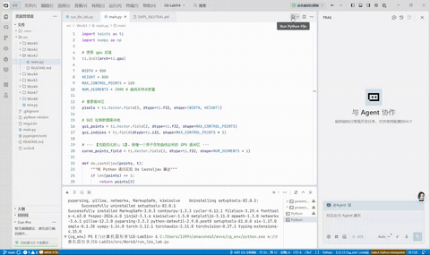

实验三 B样条曲线

姓名：黄馨莹

学号：202411081080

专业：计算机科学与技术

## 一、项目概述

本项目基于 Python + Taichi 高性能并行框架实现交互式任意阶贝塞尔曲线可视化仿真系统，采用 De Casteljau 递推算法完成曲线坐标采样计算，依托 Taichi GPU 并行架构实现像素渲染、画布刷新的高速并行运算，支持鼠标点击添加控制点、实时预览控制线、键盘一键清空画布等交互功能。项目完整复现计算机图形学贝塞尔曲线生成原理与 GPU 高速渲染流水线，解决了传统 Python 串行绘制曲线帧率低、卡顿严重的问题，是图形学基础曲线算法与高性能并行计算结合的入门实践项目。

## 二、项目架构

### 1. 项目目录结构

```
CG-Lab/
├── src/
│   └── Work1/
│       └── main.py        # 贝塞尔曲线计算、GPU渲染、交互逻辑主程序
├── .gitignore
├── pyproject.toml         # 项目依赖管理文件
└── README.md
```

### 2. 模块职责

**数据存储模块**：通过多组 Taichi Field 分别托管画布像素、曲线采样点、交互控制点与渲染索引数据，所有数据常驻 GPU 显存，为并行渲染提供高效数据支撑。

**曲线计算模块**：基于 De Casteljau 递归算法，实现任意数量控制点的贝塞尔曲线采样计算，支持任意阶平滑曲线生成。

**并行渲染模块**：依托 ti.kernel 内核，在 GPU 并行完成画布清空、曲线像素填充、画面刷新等高密度渲染任务，大幅提升绘制效率。

**交互可视化模块**：搭建 800×800 高清 GUI 窗口，监听鼠标点击添加控制点、键盘 C 键清空画布事件，实时渲染红色控制点、灰色辅助控制线与绿色平滑贝塞尔曲线。

## 三、代码逻辑

### 1. 环境初始化与参数定义

初始化 Taichi 运行后端为 GPU，定义窗口分辨率、最大控制点数量、曲线采样分段数三大核心参数。初始化四类 GPU 显存缓冲区，分别用于存储画布像素色彩、用户交互控制点、渲染索引、贝塞尔曲线采样坐标，为后续计算与渲染提供固定数据载体，避免频繁显存申请释放。

### 2. 核心曲线算法实现

封装 de\_casteljau 递归计算函数，基于线性插值原理，接收控制点数组与插值参数 t，通过逐层降阶迭代计算出单组曲线坐标。遍历 0\~1 区间内所有采样 t 值，即可批量生成完整贝塞尔曲线点阵，适配任意数量控制点的高阶曲线绘制。

### 3. GPU 并行渲染内核

内置两大 Taichi 并行内核：clear\_pixels 内核并行遍历全局像素，批量重置画布为黑色，实现高速清屏；draw\_curve\_kernel 内核并行遍历所有曲线采样点，将归一化坐标转换为屏幕像素坐标，校验坐标合法性后填充绿色像素，完成曲线并行绘制，彻底规避 CPU 串行渲染的性能瓶颈。

### 4. 主程序交互与渲染逻辑

程序开启全局窗口循环，持续监听用户交互事件：鼠标左键点击可添加控制点，上限为 100 个；按下 C 键一键清空所有控制点与曲线。每帧渲染时，若控制点数量≥2，CPU 批量完成曲线采样点计算，通过单次批量数据拷贝将点阵传入 GPU 显存，调用并行内核完成曲线绘制，同时渲染红色控制点与灰色辅助连线，实时刷新可视化效果。

## 四、实现功能

**1. 任意阶贝塞尔曲线生成**：支持 2\~100 个控制点，自动生成对应阶数的平滑贝塞尔曲线，控制点数量越多曲线拟合精度越高。

**2. 实时人机交互功能**：鼠标点击添加控制点、键盘 C 键清空画布，交互响应实时无延迟，支持动态调整曲线形态。

**3. GPU 极致并行加速渲染**：曲线计算、画布清空、像素填充均通过 GPU 并行执行，单次批量数据传输，杜绝频繁内存显存通信损耗，画面稳定高帧率无卡顿。

**4. 分层可视化展示**：红色实心点展示控制点、灰色线条展示原始控制连线、绿色平滑线条展示最终贝塞尔曲线，三层视觉分层，直观区分图形结构。

**5. 高精度曲线采样**：默认 1001 个采样点（1000 分段），兼顾曲线平滑度与运行性能，可自由修改采样参数调整精度。

**6. 全参数自定义拓展**：支持自由修改窗口分辨率、最大控制点数量、曲线采样精度、图形颜色与大小等参数，适配不同可视化需求。

## 五、效果展示

程序运行后弹出 800×800 可视化窗口，鼠标多次点击画布可生成多个红色控制点，控制点之间自动生成灰色辅助连线，并实时拟合出光滑的绿色贝塞尔曲线。随着控制点数量、位置的调整，曲线形态会实时自适应变化，按下 C 键可一键清空画布、重置所有控制点与曲线。整体画面渲染流畅、无卡顿，曲线平滑度高，交互效果直观灵敏。



<br />

## 六、运行方式

在项目根目录下执行

```
bash
uv run -m src.Work3.main
```

## 七、技术栈

语言：Python

并行计算后端：Taichi（GPU 架构）

图形可视化：Taichi GUI

核心算法：De Casteljau 贝塞尔曲线递推算法

数据运算：NumPy 数组运算 + Taichi 并行内核运算

依赖管理工具：uv
