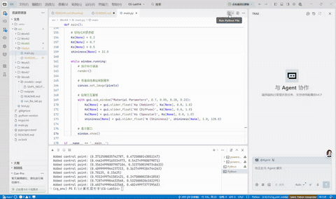

实验四 Phong光照模型

姓名：黄馨莹

学号：202411081080

专业：计算机科学与技术

## 一、项目概述

本项目基于 Python + Taichi 高性能并行框架实现基础光线追踪与 Phong 光照着色仿真系统，依托 Taichi GPU 并行架构完成屏幕像素光线发射、几何体相交检测、法向量求解与经典 Phong 光照模型渲染。程序实现球体、圆锥两种基础几何体的光线相交判定，支持环境光、漫反射、镜面高光三层光照叠加，同时提供可视化GUI滑块实时调节材质光照参数。项目完整复现计算机图形学光线追踪渲染流水线与经典局部光照模型原理，是理解光线追踪几何求交、Phong着色、材质光照调控的图形学入门实践项目。

## 二、项目架构

### 1. 项目目录结构

```
CG-Lab/
├── src/
│   └── Work3/
│       └── main.py        # 光线追踪、几何求交、Phong光照渲染主程序
├── .gitignore
├── pyproject.toml         # 项目依赖管理文件
└── README.md
```

### 2. 模块职责

**全局参数模块**：通过Taichi全局字段存储环境光系数、漫反射系数、镜面反射系数、高光指数四大材质参数，支持运行时动态修改并全局生效。

**基础工具模块**：封装向量归一化、光线反射向量计算工具函数，为几何求交与光照计算提供基础数学支撑。

**几何求交模块**：实现球体、竖直圆锥两种基础几何体的光线相交检测内核函数，可求解光线最近交点与对应表面法向量。

**光照渲染模块**：基于GPU并行像素遍历，完成光线生成、物体碰撞检测、Phong三层光照叠加、颜色裁剪输出，实现完整光线追踪渲染逻辑。

**交互控制模块**：搭建可视化GUI窗口，提供材质参数滑块调节面板，实时更新渲染画面，实现光照效果动态预览。

## 三、代码逻辑

### 1. 环境初始化与参数定义

初始化Taichi运行后端为GPU，定义800×600分辨率像素渲染缓冲区。创建四类全局可交互材质参数字段，分别对应环境光强度Ka、漫反射强度Kd、镜面反射强度Ks、高光锐度shininess，所有参数托管至GPU内核，支持实时读写修改。同时封装向量归一化、光线反射计算通用工具函数。

### 2. 几何体光线相交算法实现

程序实现两种基础三维几何体的光线追踪求交逻辑：球体求交通过构建光线与球体距离方程，求解一元二次方程得到最近交点与球面法向量；圆锥求交通过局部坐标变换，构建圆锥曲面方程，筛选合法高度范围内的有效交点，计算圆锥表面对应法向量，同时做除数防零保护，保证计算稳定性。

### 3. GPU并行光线追踪渲染内核

render内核为程序核心渲染逻辑，GPU并行遍历屏幕所有像素：根据像素坐标生成归一化屏幕光线，设定相机初始位置；依次检测光线与红球、紫圆锥的相交情况，筛选出距离相机最近的碰撞物体；若无物体碰撞则填充默认背景色，若命中物体则获取交点位置与表面法向量。

### 4. Phong光照模型计算逻辑

基于物体交点、法向量、光源位置、相机位置，完成经典Phong光照三层计算：环境光基于基础材质颜色与环境光系数叠加；漫反射根据光线与法线夹角计算漫反射强度，模拟物体受光面明暗变化；镜面反射通过光线反射向量与视线向量夹角，结合高光指数计算镜面高光效果，最终三层光照叠加并裁剪色域，输出最终像素颜色。

### 5. 主程序交互与渲染循环

初始化窗口与默认材质参数，开启全局渲染循环。每帧调用GPU并行渲染内核刷新画面，将计算结果同步至画布；内嵌GUI子窗口，提供四类光照参数滑块调节功能，用户可实时修改光照系数与高光参数，动态预览材质光影变化效果，窗口持续刷新实现实时交互渲染。

## 四、实现功能

**1. 基础光线追踪几何渲染**：支持球体、圆锥两种三维几何体的光线相交检测与画面渲染，精准呈现三维物体立体形态。

**2. 完整Phong光照模型**：完整实现环境光、漫反射、镜面高光三层光照叠加效果，还原真实物体光影与材质质感。

**实时材质参数交互调控**：提供可视化滑块面板，可动态调节Ka、Kd、Ks、高光指数参数，实时改变物体光照与材质表现。

**GPU全并行渲染加速**：所有像素光线计算、几何求交、光照运算均在GPU并行执行，渲染帧率高、画面流畅无卡顿。

**分层物体渲染与碰撞筛选**：自动检测多物体重叠区域，筛选最近碰撞点，正确实现物体遮挡关系，渲染逻辑贴合真实光学规律。

**色域安全裁剪**：对最终渲染颜色进行0-1区间裁剪，避免光照叠加过度出现画面曝光、色彩异常问题。

## 五、效果展示

程序运行后弹出渲染窗口，画面左侧展示红色球体、右侧展示紫色圆锥，物体自带自然光影明暗过渡与镜面高光效果，背景为深青灰色渐变底色。窗口右侧提供材质参数调节面板，拖动滑块可实时调整环境光亮度、物体漫反射明暗、镜面高光强度与高光聚焦范围，可直观实现哑光、磨砂、金属高亮等不同材质效果切换，光影变化实时响应、无延迟、画面渲染细腻流畅。




## 六、运行方式

在项目根目录下执行

```
bash
uv run -m src.Work4.main
```

## 七、技术栈

语言：Python

并行计算后端：Taichi（GPU 架构）

图形可视化：Taichi GUI

核心算法：光线追踪几何求交算法、Phong 局部光照模型

数据运算：Taichi 向量运算 + GPU 并行内核运算

依赖管理工具：uv
