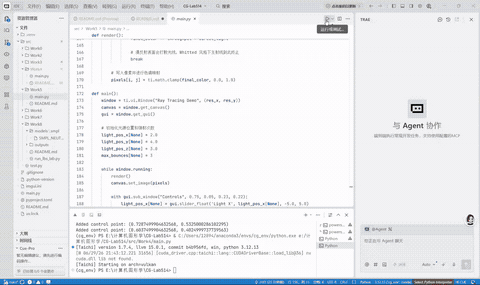

实验五 光线追踪

姓名：黄馨莹

学号：202411081080

专业：计算机科学与技术

## 一、项目概述

本项目基于 Python + Taichi 高性能并行框架实现 Whitted 风格经典光线追踪仿真系统，采用 GPU 并行架构完成逐像素光线生成、场景几何体求交、迭代式光线多级弹射、阴影射线检测与多材质物理光照渲染。程序搭建包含双球体与棋盘格平面地板的三维场景，区分漫反射哑光材质与镜面反射金属材质，支持光源三维位置实时调节、光线最大弹射阶数自定义，完整复现经典 Whitted 光线追踪渲染流水线。项目直观实现光线传播、镜面反射、物体阴影遮蔽、能量衰减等图形学核心效果，是理解基础全局光照、光线弹射迭代、多材质差异化渲染的进阶图形学实践项目。

## 二、项目架构

### 1. 项目目录结构

```
CG-Lab/
├── src/
│   └── Work4/
│       └── main.py        # 光线追踪、几何求交、多级光线弹射、多材质渲染主程序
├── .gitignore
├── pyproject.toml         # 项目依赖管理文件
└── README.md
```

### 2. 模块职责

**数据参数模块**：通过 Taichi 全局字段托管光源 XYZ 三维坐标、光线最大弹射次数等交互参数，全局常驻显存，支持运行时实时修改并作用于全局渲染内核。

**数学工具模块**：封装向量归一化、光线镜面反射计算通用工具函数，为几何求交、光线弹射更新、光照向量计算提供底层数学支撑。

**几何求交模块**：实现球体、无限水平平面两种基础几何体的光线相交检测，求解光线最近交点与表面法向量，为场景碰撞筛选提供标准化接口。

**场景管理模块**：统一场景遍历求交函数，批量检测场景内所有物体碰撞信息，区分材质类型、物体颜色与交点参数，实现多物体、多材质场景统一调度。

**光线追踪渲染模块**：基于 GPU 并行像素遍历，实现迭代式多级光线弹射、阴影射线遮挡判断、材质差异化光照计算、光线能量衰减与最终色彩叠加输出。

**交互可视化模块**：搭建 Taichi GUI 交互窗口，提供光源位置、光线弹射次数滑块控制器，实时更新渲染画面，实现参数动态调节与效果即时预览。

## 三、代码逻辑

### 1. 环境初始化与参数定义

初始化 Taichi GPU 并行计算后端，适配多平台硬件加速，定义 800×600 分辨率像素渲染缓冲区。创建全局可交互字段用于存储光源坐标与光线弹射次数，定义漫反射、镜面反射两类材质枚举标识。同时封装图形学常用向量运算函数，统一全局计算规范，为后续光线追踪流程提供稳定基础环境。

### 2. 几何体光线相交逻辑

程序实现两类基础三维几何体的光线求交算法：球体求交通过构建光线与球体距离方程，求解一元二次方程筛选正向有效交点，计算球面法向量；水平平面求交通过光线竖直分量求解交点深度，固定平面朝上法向量。所有求交逻辑仅保留最近有效交点，保证场景碰撞检测的准确性与高效性。

### 3. 场景综合碰撞与纹理生成

统一场景遍历函数依次检测红色漫反射球体、银色镜面球体与地面平面的光线碰撞，筛选距离相机最近的遮挡物体。针对地面平面实现程序化棋盘格纹理，通过世界坐标网格奇偶判断自动生成深浅交替的地板纹理，无需外部贴图资源，同时为不同物体绑定对应材质属性与基础固有色，完成场景材质与颜色初始化。

### 4. 迭代式光线追踪与光照计算

GPU 并行渲染内核逐像素生成相机光线与归一化视线向量，采用迭代循环替代传统递归结构，实现可控多级光线弹射。程序通过吞吐量变量模拟光线能量衰减，针对不同材质执行差异化渲染逻辑：镜面材质更新反射光线方向并衰减能量，持续迭代追踪次级反射光线；漫反射材质发射阴影射线检测光源遮挡，结合环境光与漫反射光照完成着色，被遮挡区域生成硬阴影，单次光线弹射结束追踪。同时对所有射线增加微小法线偏移，彻底规避光线自相交噪点问题。

### 5. 主窗口循环与交互逻辑

程序初始化默认光源位置与最大弹射次数，开启持续渲染主循环。每帧调用 GPU 并行内核完成全画面光线追踪计算，并将结果刷新至画布。内嵌 GUI 控制面板，支持实时拖拽滑块调整光源三维坐标、1\~5级光线弹射次数，动态改变场景光影分布与镜面反射精细程度，实现参数实时修改、画面即时更新的交互效果。

## 四、实现功能

**1. 标准 Whitted 迭代式光线追踪**：摒弃递归实现方式，采用迭代循环完成多级光线弹射，支持自定义弹射次数，兼顾渲染精度与运行稳定性。

**2. 双材质物理渲染模拟**：区分漫反射哑光材质与镜面反射金属材质，分别实现漫反射着色与光线镜面弹射效果，还原不同物体物理质感差异。

**3. 真实硬阴影遮挡效果**：通过阴影射线碰撞检测精准判断物体遮挡关系，未遮挡区域正常接收光照，遮挡区域生成硬阴影，还原真实光影遮蔽逻辑。

**4. 程序化棋盘格地面纹理**：通过坐标算法实时生成交替棋盘格纹理，无需外部资源，高效实现结构化地面渲染效果。

**5. 全参数动态交互调控**：支持光源 X/Y/Z 三维位置自由调节、光线最大弹射阶数可调，可直观对比不同光照位置、不同反射精度下的渲染差异。

**6. GPU 全并行高速渲染**：所有像素光线计算、几何求交、光照叠加、光线弹射逻辑均在 GPU 并行执行，高弹射次数下仍保持画面流畅稳定。

**7. 渲染抗噪优化处理**：对反射光线、阴影射线增加法线微小偏移，有效解决光线自相交导致的画面噪点、闪烁问题，提升渲染画质。

## 五、效果展示

程序运行后弹出实时渲染窗口，场景内包含左侧红色漫反射球体、右侧银色镜面反射球体与棋盘格纹理地面。漫反射球体具备自然明暗过渡与投射阴影，质感柔和；镜面球体可真实反射场景环境，呈现清晰的镜面成像效果，且随弹射次数提升反射细节更加丰富。地面棋盘纹理规整清晰，物体阴影边界分明。用户可通过右侧控制面板动态移动光源位置，实时改变场景光影角度与明暗分布，整体渲染效果真实自然、交互灵敏流畅。



<br />

<br />

## 六、运行方式

在项目根目录下执行

```
bash
uv run -m src.Work5.main
```

## 七、技术栈

语言：Python

并行计算后端：Taichi（GPU 架构）

图形可视化：Taichi GUI

核心算法：Whitted 风格光线追踪、迭代式光线多级弹射、阴影射线检测、镜面反射算法、基础漫反射光照模型

数据运算：Taichi 向量运算 + GPU 并行内核运算

依赖管理工具：uv
