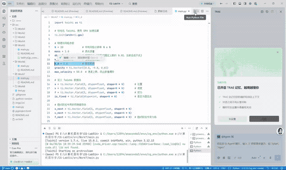
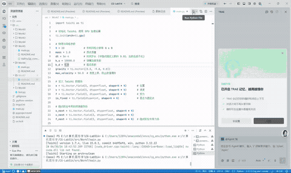
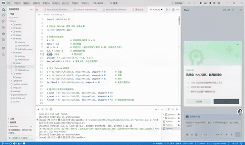
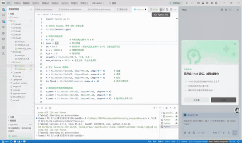
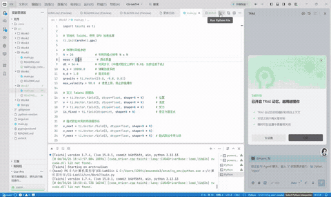

实验七 质点弹簧模型

姓名：黄馨莹

学号：202411081080

专业：计算机科学与技术

## 一、项目概述

本项目基于 Python + Taichi 高性能并行框架实现三维质点弹簧布料仿真系统，依托 Taichi GPU 并行架构完成布料网格初始化、弹簧拓扑构建、受力计算与物理积分迭代。项目完整实现**显式欧拉、半隐式欧拉、隐式欧拉定点迭代**三种主流物理积分算法，模拟布料在重力、阻尼、结构弹簧力共同作用下的自然下垂、摆动与形变效果。程序支持切换积分模式、暂停仿真、一键重置布料，同时提供可交互三维视角观察功能，直观对比不同积分算法的稳定性与物理表现差异，是计算机图形学物理模拟、柔性体仿真的经典入门实践项目。

## 二、项目架构

### 1. 项目目录结构

```
CG-Lab/
├── src/
│   └── Work5/
│       └── main.py        # 布料质点弹簧物理仿真、多积分算法渲染主程序
├── .gitignore
├── pyproject.toml         # 项目依赖管理文件
└── README.md
```

### 2. 模块职责

**参数配置模块**：统一定义布料网格分辨率、质点质量、时间步长、弹簧劲度系数、阻尼、重力、速度限制等物理超参数，统一控制仿真整体表现。

**数据存储模块**：通过多组 Taichi Field 托管质点位置、速度、受力、固定状态以及弹簧拓扑、原始长度、渲染索引等数据，全部常驻 GPU 显存，实现高速并行读写。

**场景初始化模块**：拆分位置初始化、弹簧拓扑初始化、渲染索引初始化多内核，保证 GPU 执行同步，构建规整均匀的二维布料网格结构，并固定顶端两角质点模拟悬挂布料。

**物理计算模块**：统一封装全局受力计算函数，批量计算重力、阻尼力、结构弹簧弹性力，并加入速度钳制机制，防止数值速度爆炸导致仿真发散。

**积分迭代模块**：分别实现显式欧拉、半隐式欧拉、隐式定点迭代欧拉三种积分更新策略，完成布料位置与速度的逐子步物理迭代更新。

**渲染交互模块**：搭建三维可视化场景，支持相机自由拖拽视角、实时绘制布料质点与弹簧线框，提供GUI控制面板实现算法切换、暂停、重置等交互功能。

## 三、代码逻辑

### 1. 环境初始化与物理参数定义

初始化 Taichi GPU 并行计算后端，定义 20×20 布料网格分辨率，配置统一物理仿真参数，包含质点质量、仿真时间步长、弹簧刚度、阻尼系数、重力加速度与速度上限防发散阈值。初始化多组 GPU 字段，分别存储质点位置、速度、受力、固定状态，以及弹簧拓扑关系、原长、渲染索引与隐式迭代预测缓存，为多算法物理迭代提供完整数据载体。

### 2. 布料网格与弹簧拓扑初始化

通过多阶段 GPU 内核分步初始化仿真场景：首先规整生成三维空间 XY 平面布料网格质点，固定顶端左右两角质点位置，模拟悬挂约束；其次遍历网格生成横向、纵向结构弹簧，记录每一组弹簧的质点索引与初始静止长度；最后同步生成渲染索引数组，用于后续线框绘制。分层初始化保证 GPU 计算顺序同步，避免拓扑错乱与数据覆盖问题。

### 3. 统一受力计算逻辑

封装 GPU 内联受力计算函数，分两阶段完成全局受力更新：第一阶段为所有质点统一施加重力与阻尼阻力，清空历史受力；第二阶段遍历所有弹簧，根据当前形变长度与原始长度差值计算弹性回复力，通过原子操作双向累加至两端质点，保证多线程并行计算的数据安全。同时加入速度钳制工具函数，限制质点最大运动速度，抑制数值发散。

### 4. 三类欧拉积分算法实现

**显式欧拉**：利用旧受力更新速度、旧速度更新位置，计算简单、速度最快，但稳定性极差，大刚度下极易震荡发散。

**半隐式欧拉**：先更新速度、再使用新速度更新位置，是工程最常用积分方式，在保证高效计算的同时具备良好稳定性，布料下垂效果自然顺滑。

**隐式定点迭代欧拉**：通过多轮定点迭代预测未来时刻位置与速度，反向求解受力更新状态，阻尼效果更强、稳定性最优，几乎不会发散，适合高刚度弹簧仿真场景。

### 5. 主循环交互与渲染逻辑

程序初始化布料场景并搭建三维可视窗口，配置初始相机视角、环境光与点光源。主循环持续监听 GUI 交互事件，支持一键切换三种积分算法、暂停/恢复仿真、重置布料状态；仿真运行时每帧执行多步子物理迭代，保证物理更新平滑稳定。实时渲染布料质点粒子与弹簧线框网格，支持鼠标拖拽旋转视角、缩放场景，全方位观察布料动态下垂与摆动形变效果。

## 四、实现功能

**1. 完整质点弹簧布料物理仿真**：基于结构弹簧+重力+阻尼构建完整柔性体物理模型，模拟真实布料悬挂下垂、自由摆动形变效果。

**2. 三种欧拉积分算法对比仿真**：原生实现显式、半隐式、隐式定点迭代三种积分方案，可实时切换，直观对比算法稳定性差异。

**3. GPU 全并行高速物理迭代**：所有受力计算、积分更新、网格遍历均在 GPU 并行执行，单内核整合计算逻辑，大幅降低 GPU 调度开销，仿真流畅高效。

**4. 防发散数值优化机制**：配置速度上限钳制、微小距离容错、原子力累加等多重优化，有效抑制高速震荡与数值爆炸问题。

**5. 可视化交互控制系统**：支持算法切换、仿真暂停、一键重置，搭配三维自由相机，可多角度观察布料仿真细节。

**6. 线框+粒子双层渲染**：同时绘制蓝色质点顶点与白色弹簧网格线，结构清晰，便于观察布料拓扑形变与整体运动趋势。

## 五、效果展示

程序运行后弹出三维仿真窗口，展示四角悬挂、顶端两角固定的方形布料网格。切换半隐式欧拉算法时，布料受重力自然下垂、摆动柔和稳定，无异常震荡；切换显式欧拉算法时，布料会出现剧烈抖动、高频震荡并快速发散崩坏；切换隐式欧拉算法时，布料运动最为平稳、阻尼感更强，形变收敛柔和。用户可随时暂停仿真观察静态形态，一键重置恢复初始状态，拖拽鼠标可自由旋转、缩放视角，全方位观察布料物理仿真细节，不同算法的稳定性差异直观明显。

阻尼为1，质点质量为1：



阻尼为5，质点质量为1：



阻尼为10，质点质量为1：



阻尼为1，质点质量为5：



阻尼为1，质点质量为10：




## 六、运行方式

在项目根目录下执行

```
bash
uv run -m src.Work5.main
```

## 七、技术栈

语言：Python

并行计算后端：Taichi（GPU 架构）

图形可视化：Taichi GGUI 三维场景渲染

核心算法：质点弹簧物理模型、显式/半隐式/隐式欧拉积分、定点迭代求解、弹性力学模型

数据运算：Taichi 向量运算 + GPU 大规模并行物理迭代

依赖管理工具：uv
