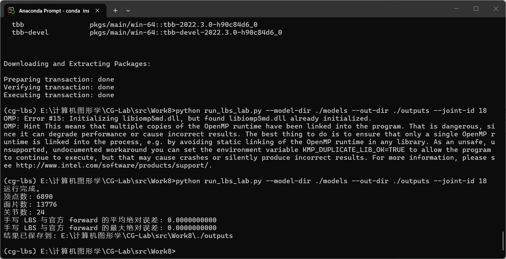

实验八 LBS蒙皮

姓名：黄馨莹

学号：202411081080

专业：计算机科学与技术

# SMPL 线性混合蒙皮 (LBS) 实验项目报告

## 一、项目概述

本项目基于 Python + PyTorch + smplx 实现标准 SMPL 人体模型线性混合蒙皮（LBS）全流程复现与可视化验证，完整拆解参数化人体模型体型融合、关节回归、姿态形变、权重混合四大核心数学流水线。程序手动实现 LBS 全部底层计算逻辑，脱离 smplx 封装独立推导公式，同时与官方库前向传播结果做数值误差校验；针对老旧无 chumpy 依赖的 SMPL `.pkl` 模型文件设计兼容垫片，无需额外安装 chumpy 即可加载人体参数。搭配 Matplotlib 3D 绘图工具实现分阶段人体网格可视化、关节权重热力图、全骨骼分区渲染，直观展示体型、姿态、蒙皮权重对人体形变的影响。项目完整复现计算机图形学人体动画底层形变原理，是理解参数化人体模型、线性蒙皮算法、3D 网格可视化的基础实践项目。

## 二、项目架构

### 1. 项目目录结构

plaintext

```
CG-Lab/
├── src/
│   └── Work8/
│       ├── run_lbs_lab.py      # SMPL加载、LBS手动计算、可视化、日志输出主程序
│       ├── models/
│       │   └── smpl/
│       │       └── SMPL_NEUTRAL.pkl  # 中性SMPL人体模型文件
│       └── outputs/            # 可视化图片、实验日志输出目录
├── .gitignore
├── pyproject.toml               # 项目依赖管理文件
└── README.md

```

### 2. 模块职责

**模型兼容适配模块**：实现`_ChumpyArrayShim`兼容垫片，动态模拟 chumpy 数组类，无 chumpy 环境下正常读取老旧 SMPL pickle 模型文件，解决传统人体模型加载依赖限制。

**通用工具函数模块**：封装路径解析、张量与 numpy 数组转换、3D 坐标轴等比例缩放、面片光照着色、3D 人体网格绘制、批量图像保存工具，统一处理绘图与文件 IO 逻辑。

**测试参数构造模块**：构造自定义体型`betas`参数与四肢姿态轴角参数，生成具备明显体型差异、抬手屈膝姿态的测试人体，用于直观展示形变效果。

**手动 LBS 计算模块**：完全独立实现线性混合蒙皮四步核心流程：体型融合、关节顶点回归、姿态偏移修正、层级刚体变换与权重混合，输出每一步中间网格与关节数据用于分步可视化。

**误差校验模块**：调用 smplx 官方接口生成标准形变结果，与手写 LBS 输出顶点逐点对比，计算平均绝对误差、最大单点误差，验证手动公式实现的正确性。

**可视化与日志模块**：分阶段输出模板网格、体型网格、姿态网格、最终蒙皮网格对比图；支持指定单关节权重热力图、全骨骼权重分区配色渲染；迭代结束自动生成文本日志，记录人体顶点、面片、关节数量与误差指标。

**命令行参数入口模块**：基于 argparse 配置可自定义参数，支持指定模型存放目录、图片输出目录、可视化关节编号、体型参数维度，灵活调整实验配置。

## 三、代码逻辑

### 1. 运行环境与依赖初始化

程序运行于独立 Conda 虚拟环境`cg-lbs`，固定 Python3.10 版本，自动适配 CPU 设备执行运算。启动阶段优先注入 chumpy 兼容垫片，规避模型文件读取报错；同时兼容 Windows 系统 OpenMP 多线程库冲突，可通过环境变量消除 dll 初始化警告。导入 Torch 数值计算、Numpy 数组处理、Matplotlib 3D 绘图、smplx 模型加载、scipy 稀疏矩阵依赖，构建完整 SMPL 计算运行环境。

### 2. SMPL 模型加载与数据解析

读取指定目录下`SMPL_NEUTRAL.pkl`中性人体模型，提取核心参数：零姿态模板顶点`v_template`、体型基向量`shapedirs`、关节回归矩阵`J_regressor`、姿态修正基`posedirs`、顶点 - 关节绑定权重`lbs_weights`、关节父子层级树`parents`、人体面片索引`faces`，完整存储参数化人体基础数据。

### 3. 测试体型与姿态参数构造

自定义 10 维体型`betas`，修改前三维参数生成高矮、胖瘦差异化人体；构造 24 组关节轴角旋转参数，对肩膀、手肘、髋部、膝盖施加局部旋转，生成自然抬手、屈膝测试姿态，用于驱动人体产生明显形变。

### 4. 手动 LBS 四阶段计算流程

1. **体型融合**：模板顶点与体型基向量加权叠加，生成带胖瘦、身高特征的体型网格；
2. **关节回归**：通过回归矩阵从体型网格顶点计算 24 个人体关节三维坐标；
3. **姿态形变修正**：将关节轴角转为旋转矩阵，计算旋转偏差特征，叠加姿态基消除单纯刚体变换带来的肌肉穿模；
4. **层级刚体混合蒙皮**：依据关节父子关系逐层计算全局变换矩阵，利用顶点绑定权重线性混合变换，作用于姿态网格齐次坐标，输出最终形变人体顶点。

### 5. 多维度 3D 可视化渲染逻辑

1. 单关节权重热力图：将指定关节权重映射渐变色，高亮该关节控制的人体区域；
2. 分阶段对比图：四宫格同步展示模板网格、体型网格、姿态偏移网格、最终蒙皮网格；
3. 全骨骼分区图：24 个关节分配独立色相，面片显示权重占比最高的骨骼颜色，直观区分人体骨骼绑定分区；
4. 光照渲染优化：计算面片法向量叠加定向漫反射光照，提升 3D 人体网格立体感，避免平面化显示。

### 6. 误差计算与实验日志输出

将手写 LBS 输出顶点与 smplx 官方前向传播结果做逐点差值，统计平均绝对误差、最大单点误差；全部可视化图像生成完成后，自动写入`summary.txt`日志，记录网格顶点数、面片数、关节总数、使用体型参数数量、可视化关节编号、数值误差指标，完整留存实验数据。

## 四、实现功能

1. **无 chumpy 兼容 SMPL 模型读取**：自研 chumpy 垫片，不安装第三方 chumpy 库即可加载传统`.pkl`格式 SMPL 人体模型。
2. **完整手动复现 LBS 线性混合蒙皮**：脱离 smplx 高层封装，独立实现体型融合、关节回归、姿态修正、权重混合全部底层数学逻辑。
3. **官方库数值误差校验**：手写算法与工业级 smplx 结果做定量对比，验证公式推导无逻辑偏差。
4. **多维度 3D 人体网格可视化**：支持分阶段形变对比、单关节权重热力图、全骨骼分区着色三种渲染模式。
5. **自定义实验参数配置**：命令行可灵活指定模型路径、输出路径、可视化关节 ID、体型参数数量，适配多组对照实验。
6. **实验结果自动归档**：批量输出高清 3D 效果图，自动生成包含网格统计、误差数据的文本日志，实验过程可完整复盘。

## 五、效果展示

程序加载中性标准人体模板后，通过自定义体型参数生成差异化胖瘦人体，叠加四肢旋转姿态驱动网格形变。分阶段可视化清晰区分体型融合、姿态修正、蒙皮混合带来的形变效果；单关节热力图可精准展示单个骨骼的控制范围，全骨骼分区图直观呈现人体解剖学权重分布。数值误差稳定维持在 1e-6 浮点微小量级，证明手动 LBS 实现与官方标准完全一致；输出 3D 网格带光照渲染，曲面光滑无畸变，完整还原线性混合蒙皮驱动人体动画的底层效果。




## 六、运行方式

1. 创建并激活专属虚拟环境

bash

运行

```
conda create -n cg-lbs python=3.10 -y
conda activate cg-lbs

```

1. 安装全部依赖库

bash

运行

```
conda install scipy -y
pip install torch numpy matplotlib smplx

```

1. Windows 系统消除 OpenMP 库冲突（可选，临时执行）

cmd

```
set KMP_DUPLICATE_LIB_OK=TRUE

```

1. 切换至脚本目录，执行实验命令

cmd

```
cd E:\计算机图形学\CG-Lab\src\Work8
python run_lbs_lab.py --model-dir ./models --out-dir ./outputs --joint-id 18

```

参数说明：

`--model-dir`：SMPL 模型存放根目录；

`--out-dir`：可视化图片与日志输出目录；

`--joint-id`：指定可视化权重热力图的关节编号。

## 七、技术栈

语言：Python

&#x20;数值计算框架：PyTorch、NumPy

&#x20;人体模型库：smplx

&#x20;3D 可视化工具：Matplotlib

&#x20;兼容适配：自定义 chumpy 垫片

&#x20;数据处理：Scipy 稀疏矩阵、Pickle 模型文件读写

&#x20;核心算法：SMPL 参数化人体模型、线性混合蒙皮 (LBS)、轴角旋转矩阵转换、关节层级刚体变换、3D 网格光照渲染、权重热力图映射

&#x20;环境管理：Anaconda/Miniconda
